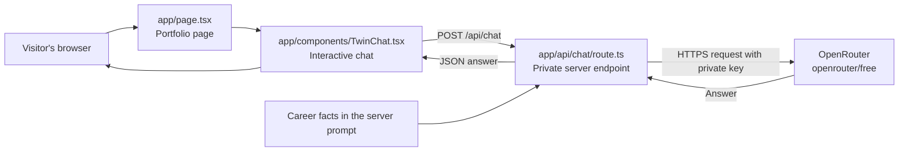

# A Beginner’s Guide to This Portfolio Website

This guide walks through the portfolio website in this project: how it is put together, how the career history is displayed, how the digital twin chat works, and where to make changes. It assumes you are new to frontend development and explains the important ideas as they appear in the code.

## 1. What the website uses

| Technology | What it does here |
| --- | --- |
| **Next.js 16** | Runs the site, organizes pages and API endpoints, and builds the production version. |
| **React 19** | Creates the page from reusable interface components and manages the interactive chat. |
| **TypeScript** | Adds types to JavaScript so the editor and compiler can catch many mistakes early. |
| **HTML and JSX** | Describe the content and structure of the page. JSX lets React markup live inside TypeScript files. |
| **CSS** | Controls the colors, layout, typography, responsive behavior, and chat states. |
| **OpenRouter** | Receives chat requests from the server and routes them to the `openrouter/free` model. |

There is no separate CSS framework or chat SDK. The site uses custom CSS and calls OpenRouter with the browser’s built-in `fetch` API from a server route.

## 2. Start the site locally

Open a terminal in the project folder and run:

```powershell
npm install
npm run dev
```

Then visit [http://localhost:3000](http://localhost:3000). `npm install` downloads the packages listed in `package.json`; it is only needed after cloning the project or when dependencies change. `npm run dev` starts Next.js in development mode, which refreshes the page as you edit files. Press **Ctrl+C** in that terminal to stop it.

To make and run a production build:

```powershell
npm run build
npm run start
```

The chat needs `OPENROUTER_API_KEY` in the project-root `.env` file. Keep the real value private. Do not put it in a React component, commit it to source control, or rename it with a `NEXT_PUBLIC_` prefix. The `.gitignore` file excludes `.env` so the key is not accidentally committed.

## 3. How the pieces fit together



The key design decision is that the browser talks to **our own** `/api/chat` endpoint. The endpoint runs on the server, reads the secret key, adds career information, then calls OpenRouter. The browser receives the answer, but never receives the API key.

## 4. A quick tour of the files

```text
app/
  api/chat/route.ts       Server-side chat endpoint
  components/TwinChat.tsx Interactive chat interface
  globals.css             Site-wide and responsive styles
  layout.tsx              Shared HTML shell and page metadata
  page.tsx                Homepage and career content
public/
  resume.pdf              Résumé offered for download
.env                     Local private configuration; do not share or commit
.gitignore               Files Git should leave out
next.config.ts            Next.js configuration
package.json              Dependencies and terminal commands
tsconfig.json             TypeScript settings
```

## 5. The shared page shell: `app/layout.tsx`

Next.js uses `app/layout.tsx` as the shared outer frame for pages in the App Router. It sets the document language, loads the site stylesheet, and provides metadata used by the browser and link previews.

```tsx
import type { Metadata } from "next";
import "./globals.css";

export const metadata: Metadata = {
  title: "Michael Sargent — Senior Software Engineer",
  description: "A short description of the portfolio.",
};

export default function RootLayout({ children }: Readonly<{ children: React.ReactNode }>) {
  return (
    <html lang="en">
      <body>{children}</body>
    </html>
  );
}
```

`children` means “whatever page is being shown inside this shared shell.” `Metadata` is a TypeScript type that helps ensure the metadata fields have the right shape.

## 6. The homepage: `app/page.tsx`

### Career data is separate from its presentation

Near the top of the file, `roles` is an array. An **array** is an ordered list; each item in this array is an **object** containing fields such as `years`, `role`, `company`, `detail`, and `tags`.

```tsx
const roles = [
  {
    years: "OCT 2025 — NOW",
    role: "Founder & Engineer",
    company: "Lamp Light Labs",
    detail: "Building a production job-search intelligence product.",
    tags: ["AI / RAG", "C# / .NET", "Azure"],
    index: "01",
  },
  // Other positions follow the same shape.
];
```

Keeping the role details in one data structure makes the timeline easier to scan and update than repeating a large block of markup for every job. Be sure the dates and claims here stay consistent with the current résumé.

### React repeats each timeline entry

Later, the page maps over that array:

```tsx
<div className="timeline">
  {roles.map((item) => (
    <article className="timeline-entry" key={item.index}>
      <div className="timeline-meta">
        <span className="timeline-years">{item.years}</span>
      </div>
      <div className="timeline-body">
        <h3>{item.role}</h3>
        <div className="timeline-company">{item.company}</div>
        <p>{item.detail}</p>
        <div className="tag-row">
          {item.tags.map((tag) => <span key={tag}>{tag}</span>)}
        </div>
      </div>
    </article>
  ))}
</div>
```

`.map()` takes each item and returns a piece of the page for it. Curly braces `{...}` insert a JavaScript expression into JSX. The `key` gives React a stable identifier so it can track entries when content changes. The inner `map` does the same job for skill tags.

The homepage groups the work into sections: an introduction, career highlights, about section, working principles, career timeline, earlier experience, selected work, chat, and contact footer. Links such as `href="#journey"` jump to an element with `id="journey"` on the same page. The résumé link points to `/resume.pdf`, which Next serves from the `public` folder.

The “Earlier experience” area lists Iberon, Technology Industries, and BAE Systems as separate jobs. The State Department role appears in the main timeline because its 2018–2020 dates are later than those earlier roles. Education is displayed separately.

## 7. Styling and layout: `app/globals.css`

CSS selectors describe which elements to style. For example, `.timeline-entry` selects elements whose `className` is `timeline-entry`; `h3` selects all level-three headings.

The stylesheet defines theme values as **CSS custom properties** (also called variables):

```css
:root {
  --ink: #252321;
  --paper: #f4f1ed;
  --green: #c65a32; /* accent color; the name is historical */
  --acid: #f1a16f;
}

body {
  color: var(--ink);
  background: var(--paper);
}
```

`var(--ink)` reuses a value. This helps a palette feel consistent: change the variable once and every rule that uses it can follow. The active preview is **palette 2: charcoal and burnt orange**. Responsive `@media` rules adjust spacing and grids for narrower tablet and phone screens. The system-font stacks keep the page readable without waiting for a remote font download. Reduced-motion preferences are also respected for the scroll behavior and transitions.

## 8. The chat interface: `app/components/TwinChat.tsx`

Most of the page can be rendered on the server, but chat needs to react to typing and clicks in the browser. The first line marks this component as a **Client Component**:

```tsx
"use client";

import { FormEvent, KeyboardEvent, useRef, useState } from "react";
```

Without that directive, browser-only React state and event handlers cannot run in this component. The `"use client"` boundary is kept around the chat rather than making the whole homepage interactive.

### State: the changing parts of the interface

```tsx
const [messages, setMessages] = useState<Message[]>([]);
const [draft, setDraft] = useState("");
const [sending, setSending] = useState(false);
const [error, setError] = useState("");
```

**State** is information React remembers between renders. `messages` holds the conversation, `draft` holds the text being typed, `sending` disables repeat submissions while a request is in flight, and `error` displays a recoverable problem. Calling a setter such as `setDraft(...)` updates the state and asks React to redraw the relevant UI.

`useRef` stores a reference to a real browser element. Here it lets the component scroll the chat feed to the newest message and return keyboard focus to the text box after a reply.

### Sending a message

The component’s `sendMessage` function trims the draft, adds the user message, and sends the most recent conversation turns to the local API route:

```tsx
const response = await fetch("/api/chat", {
  method: "POST",
  headers: { "Content-Type": "application/json" },
  body: JSON.stringify({ messages: nextMessages.slice(-12) }),
});

const data = await response.json();
if (!response.ok || typeof data.answer !== "string") {
  throw new Error(data.error ?? "Please try again in a moment.");
}

setMessages([...nextMessages, { role: "assistant", content: data.answer }]);
```

`fetch` is the browser’s built-in way to make an HTTP request. `POST` means “send data to the server.” `JSON.stringify` converts JavaScript objects into JSON text for transport. The server’s JSON response is parsed with `response.json()`. On success, the answer is added as an assistant message. On failure, the existing question stays in the conversation and the interface offers a retry.

The form supports both clicking the send button and pressing **Enter**; **Shift+Enter** inserts a new line. The suggestion buttons call the same send function with ready-made questions. ARIA labels and a live region help screen readers identify the form and hear new chat content.

## 9. The private API endpoint: `app/api/chat/route.ts`

In the App Router, a `route.ts` file defines an HTTP endpoint. This file exports a `POST` function, so the browser’s request to `/api/chat` runs this code on the server:

```ts
export async function POST(request: Request) {
  const payload = await request.json();
  // Validate the request, call the model, return JSON.
}
```

The route checks that the request is valid JSON, contains 1–12 messages, uses only `user` and `assistant` roles, and keeps each message within the size limit. It also rejects an oversized request body and requires the final message to be from the user. These checks catch common malformed requests before calling the model.

The career profile and work history are placed in a **system prompt**: background instructions sent to the model before the conversation. It tells the model to answer from the résumé facts, avoid inventing claims, and admit when a detail is unknown. The caller’s messages are then appended to that prompt.

The actual provider call is made from the server:

```ts
const apiKey = process.env.OPENROUTER_API_KEY;
if (!apiKey) return reply(503, "The chat is not configured yet. Please try again later.");

const upstream = await fetch("https://openrouter.ai/api/v1/chat/completions", {
  method: "POST",
  headers: {
    Authorization: "Bearer " + apiKey,
    "Content-Type": "application/json",
    "X-Title": "Michael Sargent Career Twin",
  },
  body: JSON.stringify({
    model: "openrouter/free",
    messages: [{ role: "system", content: systemPrompt }, ...messages],
    max_tokens: 1024,
    reasoning: { effort: "none" },
    temperature: 0.4,
  }),
  signal: AbortSignal.timeout(35_000),
  cache: "no-store",
});
```

`process.env.OPENROUTER_API_KEY` reads a server environment variable. It is never sent to the client. The `Authorization` header proves to OpenRouter that this server is allowed to make the request. `model` selects the free-model router. `temperature` adjusts how varied answers are; lower values tend to be more consistent. The timeout prevents a request from hanging forever, and `cache: "no-store"` prevents treating chat responses as reusable cached content.

The route returns a JSON answer for the chat UI. It converts common upstream failures into short messages, rather than exposing provider internals to visitors. For example:

```ts
return NextResponse.json({ answer: answer.trim() });
```

The system prompt is included in the server route, not the client component. That keeps the request policy and résumé context out of the browser bundle, though anything sent to a third-party model is still processed by that provider.

## 10. A typical chat request, step by step

1. A visitor types a question and presses Enter.
2. React stores the question and displays it immediately.
3. The chat component sends the last 12 turns to `/api/chat` as JSON.
4. The route checks the body and messages.
5. The route reads the OpenRouter key from the server environment and adds its system prompt.
6. OpenRouter routes the request to a free model and returns a completion.
7. The route validates that the completion has answer text and returns it as JSON.
8. React appends the answer to the conversation and restores focus to the input.

## 11. Safe editing tips

- **Changing a job:** edit the matching object in the `roles` array. Keep date ranges newest first and make sure the description matches the résumé.
- **Changing a color:** edit the theme variables and the palette overrides in `globals.css`. CSS rules appearing later can override earlier ones.
- **Changing the chat welcome text or suggestions:** edit `TwinChat.tsx`.
- **Changing the model behavior or career facts:** edit `systemPrompt` in `app/api/chat/route.ts`.
- **Changing private configuration:** update `.env`, never a `.tsx` file. Restart `npm run dev` after changing environment variables.
- **Adding a new page:** add a folder under `app` and put a `page.tsx` inside it. For example, `app/about/page.tsx` becomes `/about`.

## 12. Five improvements suggested by a self-review

1. **Normalize text encoding.** Some source strings appear to contain mojibake such as `résumé` and `Let’s`. Save the files as UTF-8 and replace those strings with the intended characters; add a simple content check to catch regressions.
2. **Add rate limiting.** The API validates message sizes, but it has no per-visitor request limit. A server-side rate limiter would reduce automated abuse and protect the free-model quota.
3. **Create one source of truth for career facts.** Job data appears both in the rendered timeline and in the chat system prompt. Store it in a shared typed data file so both views can use the same verified facts.
4. **Consolidate palette previews.** `globals.css` contains successive palette-preview override blocks. Keep the selected palette in one clearly named theme block—or use a theme attribute—so future edits do not need to account for several layers of overrides.
5. **Add automated checks.** Add tests for invalid chat payloads and provider errors, plus browser checks at desktop and mobile widths. Include keyboard navigation and contrast checks so new UI changes remain usable for more people.
